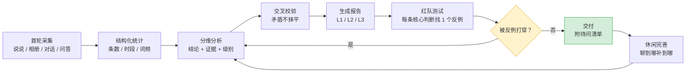

# tact-profile

一份**可复用的个人画像方法论**——把「我觉得他是这样的人」变成「每条结论都有出处」。

不收集数据，不预测命运，只做一件事：**用证据建画像，用纠偏保准确**。

---

## 它解决什么问题

大多数人做「用户画像 / 人物分析」，结果长这样：

> 「他是一个热爱游戏、内心细腻、渴望被理解的人。」

无法验证，无法反驳，也无法使用。

这个 skill 用四条纪律替换它们：

| 纪律 | 做法 |
| --- | --- |
| **证据分级** | A 本人陈述 / B 行为日志 / C 推断 / D 玄学 |
| **语境判定** | 认真陈述、玩梗、为聊天而问——价值完全不同 |
| **纠偏留痕** | 用户纠正事实 → 重算依赖它的判断，错误不删 |
| **红队测试** | 对核心判断各找 1 个反例，找不到才算稳 |



这个循环里，**红队测试是唯一会把你打回去的环节**——它的作用是防止「标签太满」。

---

## 目录

```
tact-profile/
├─ SKILL.md                流程、7 条硬规则、自检清单
├─ SECURITY.md             不含真实数据说明
├─ references/
│  ├─ INDEX.md             总索引与交叉分工
│  ├─ dimensions.md        十个维度 + 能推/不能推
│  ├─ domains.md           13 个垂类（动画/游戏/阅读/职业/运动…）
│  ├─ platforms.md         13 类输入源（QQ/微博/小红书/X/日记…）
│  ├─ interest-screening.md 13 题兴趣雷达（不追星就不问追星）
│  ├─ question-bank.md     20 问 / 100 问 / 平台特化问法
│  ├─ consumption.md       消费品类矩阵
│  ├─ lifestyle.md         出行/环保/居住/物品
│  ├─ worldview.md         三观 + 宗教 + 弱信号拼图
│  ├─ metaphysics.md       星座/紫微/周易（只进附录）
│  ├─ life-events.md       健康与重大事件（写影响不写病历）
│  ├─ sensitive.md         亲密关系（默认关闭）
│  ├─ privacy.md           三档披露 + 可识别性检查
│  ├─ correction.md        纠偏协议
│  ├─ interview-loop.md    首轮采集 + 休闲完善
│  └─ output-l1/l2/l3.md   三级输出模板
└─ examples/
   └─ 示例画像-虚构.md      虚构人物演示
```

---

## 怎么用

### 安装

把整个 `tact-profile/` 目录放进你的 skill 扫描根：

| 位置 | 优先级 |
| --- | --- |
| `<项目>/.dsh/skills/` | 最高 |
| `<项目>/.agents/skills/` | 次之 |
| `~/.dsh/skills/` | 用户级 |

下一轮请求自动生效。

### 两种模式

**首轮采集**：有大量数据时，一次性灌入（说说/相册/对话/问答），按流水线建初版。

**休闲完善**：初版之后，不设议题，聊到哪补到哪——目的是帮你更了解自己，不是收集数据。

### 输出分级

| 级别 | 篇幅 | 适合 |
| --- | --- | --- |
| L1 | 1 页 | 快速了解 |
| L2 | 5–8 页 | 常规 |
| L3 | 分篇长文 | 有 ≥1 年全量日志，或本人要「完整版」 |

---

## 一个判断长什么样

```markdown
| 判断 | 证据 | 级别 | 语境 |
| --- | --- | --- | --- |
| 要确定性，不要刺激 | 抽卡礼包卖光就停，保底即满足 | A | 认真 |
| 夜型作息 | 600 条动态的时间分布 | B | — |
| 关系靠共同活动维持 | 群都是「一起玩」起家 | C | 推断 |
```

**级别不够的，不写成结论；语境不明的，先问。**

---

## 边界

- 不诊断心理疾病，不推断性取向、健康、政治立场（除非本人明说）
- 玄学只进附录，标「本人是否认同」
- 亲密维度默认关闭，本人提出才做
- 数据只存本地，不上传

---

## 示例

[`examples/示例画像-虚构.md`](examples/示例画像-虚构.md) —— 虚构人物「阿澈」，演示完整输出格式。

---

## 来源

方法论来自一次真实的长期实践：3997 条社交动态、29857 张相册、508 条对话记录、多轮本人纠偏（12 条判断被推翻过）。

**但仓库里不含任何真实数据**——示例是编的。

---

## License

CC BY-NC 4.0 —— 可自由使用、修改、分享，署名，非商业。
