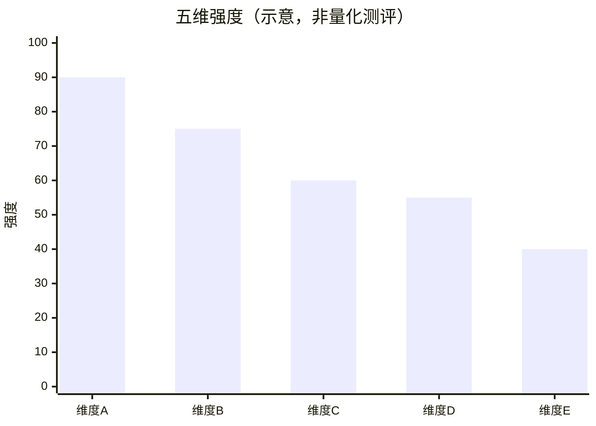

# L1 轻量卡模板

适用：首次接触、数据不足一个月、或用户只要「快速了解我」。

篇幅：**1 页**。写完不超过 500 字。

## 模板

```markdown
# {名字} · 画像速览

> 级别 L1｜数据：{来源，如「20 问 + 3 个月说说」}｜{日期}

## 一句话
> {一句话讲清「他是谁、被什么驱动、在哪停下」}

## 五个关键词
| 词 | 含义 |
| --- | --- |
| ① | |
| ② | |
| ③ | |
| ④ | |
| ⑤ | |

## 三条可用建议
1.
2.
3.

## 三个缺口
- 不知道：
- 不知道：
- 不知道：
```

## 写法要求

- 一句话必须包含「驱动 + 边界」，只写「热爱游戏」不合格。
- 关键词每条 10 字以内，后面跟一句解释。
- 建议要能落地（「给他的产品做 X」），不要「多沟通」这种空话。
- 缺口写具体问题，不写「信息不足」。

## 配图（1 张，可选）

L1 只有一页，最多配一张图——建议用五维条形：



**注意**：图下必须写「示意，不代表高低优劣」。

## 例子（压缩版）

> 被广阔远景和纸片人拉进来，靠连续可恢复的战斗交互留下来，全成就 + 90% 结案；每日签到是退坑线。
>
> 关键词：可恢复的难 / 连续交互 / 6:4 / 纸片人 / 全成就。
